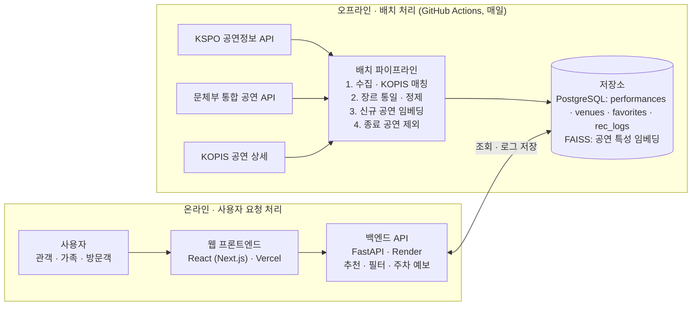

# 올림픽공원 공연 추천 시스템 — 웹 개발 워크플로우

작성일: 2026-11-08 · 작성자: 임지우

## 1. 프로젝트 개요

올림픽공원에서 열리는 공연·행사를 사용자의 취향·방문 날짜·동행 유형에 맞춰 추천하고, 공연 당일 주차 혼잡 정보까지 함께 안내하는 웹 서비스를 8주 안에 MVP로 만든다.

- **배경**: 올림픽공원에는 KSPO DOME, 우리금융아트홀, 핸드볼경기장, 88잔디마당, 수변무대 등 공연장이 모여 있지만, 홈페이지는 일정 나열 위주라 "나에게 맞는 공연"을 찾기 어렵다.
- **목표**: (1) 장르·아티스트 취향 기반 추천, (2) 날짜·동행(가족·연인·혼자)·예산 조건에 맞는 공연 추천, (3) 공연일 주차 혼잡 예보 연계.
- **대상 사용자**: 공연 관객, 아이와 오는 가족, 공원 산책 중 즉석 관람을 원하는 방문객.
- **범위(MVP)**: 공연 목록·상세, 취향 온보딩, 3종 추천, 찜·관심 알림. 예매는 직접 하지 않고 예매처 링크로 연결한다.

## 2. 활용 데이터

핵심 데이터는 한국체육산업개발의 올림픽공원 공연정보이고, 장르·출연진·줄거리처럼 추천에 필요한 특성은 KOPIS 등 외부 데이터로 보강한다.

| 데이터 | 제공처 | 주요 항목 | 활용 목적 |
| --- | --- | --- | --- |
| 올림픽공원 공연정보 (필수) | 한국체육산업개발 · [개방목록](https://www.data.go.kr/dcat/metadata/15147873) | 공연명, 기간, 장소, 홈페이지 URL | 추천 대상 카탈로그 |
| [공연 정보(통합) API](https://www.data.go.kr/data/15056881/openapi.do) | 문화체육관광부 (한국체육산업개발 포함 10개 기관) | 제목, 기간, 시간, 장소, 공연시간, 요금 등 표준 24개 칼럼 | 요금·시간 등 필터용 표준 필드 |
| [영문 공연정보](https://www.data.go.kr/data/15149169/fileData.do) | 한국체육산업개발 (286행) | 행사명, 기간, 장소 (뮤지컬·콘서트·페스티벌·어린이 공연 등) | 과거 공연 이력, 장르 분포 분석 |
| KOPIS 공연예술통합전산망 API (외부) | 예술경영지원센터 | 장르, 출연진, 줄거리, 관람연령, 포스터, 예매상황판 | 콘텐츠 특성·인기도 보강 |
| [올림픽공원 주차·혼잡도 데이터](https://www.data.go.kr/data/15164822/openapi.do) (선택) | 한국체육산업개발 (7,803건) | 입·출차, 공연, 날씨 | 공연일 주차 혼잡 예보 |

확인할 것:

- [ ] 활용신청 후 KSPO 공연정보 응답 필드에 장르·설명이 있는지 확인
- [ ] KSPO 공연과 KOPIS 공연의 매칭 키 결정 (공연명+기간+장소)
- [ ] 과거 공연 데이터가 몇 년치 쌓여 있는지 확인 — 취향 학습에 쓸 수 있는 범위
- [ ] KOPIS API 키 발급 및 호출 한도 확인

## 3. 전체 워크플로우 한눈에 보기

8단계를 순서대로 진행하되, 4단계(추천 모델)와 5·6단계(백엔드·프론트)는 API 명세를 먼저 확정해 병렬로 진행한다.

| 단계 | 핵심 작업 | 산출물 | 주차 |
| --- | --- | --- | --- |
| 1. 기획·요구사항 정의 | 페르소나, 유저 스토리, 기능 명세 | 요구사항 명세서, 와이어프레임 | 1주 |
| 2. 데이터 수집 | KSPO·통합·KOPIS API 수집, 매일 동기화 스크립트 | 원천 데이터(raw), 수집 스크립트 | 1\~2주 |
| 3. 전처리·EDA | 출처 간 공연 매칭, 장르 체계 통일, 요금·연령 정규화 | 정제 테이블, EDA 리포트 | 2주 |
| 4. 추천 모델 | 공연 특성 임베딩, 조건 필터, 점수 조합, 오프라인 평가 | 추천 모듈, 평가 결과 | 3\~4주 |
| 5. 백엔드 | DB 스키마, REST API, 추천 서빙 | API 서버, API 명세서 | 4\~5주 |
| 6. 프론트엔드 | 온보딩·홈·상세·마이페이지, 반응형 UI | 웹 클라이언트 | 5\~6주 |
| 7. 테스트·개선 | 단위·통합 테스트, 사용성 테스트 5명 | 테스트 리포트, 개선 목록 | 7주 |
| 8. 배포·운영 | 클라우드 배포, 매일 데이터 갱신, 로그 수집 | 서비스 URL, 운영 매뉴얼, 발표 자료 | 8주 |

## 4. 단계별 상세

각 단계는 아래 완료 기준을 만족해야 다음 단계로 넘어간다.

### 4.1 기획·요구사항 정의

- 페르소나 3종: 좋아하는 아티스트가 뚜렷한 콘서트 관객, 주말에 아이와 볼 공연을 찾는 부모, 공원에 온 날 볼 만한 걸 찾는 방문객.
- 핵심 유저 스토리: "장르와 날짜를 고르면 그날 올림픽공원에서 볼 만한 공연과 주차 혼잡도를 한눈에 본다."
- 완료 기준: 기능 목록(필수/선택), 화면 와이어프레임 4장(온보딩·홈·상세·마이페이지), 성공 지표 합의.

### 4.2 데이터 수집

- 공공데이터포털에서 KSPO 공연정보·통합 공연 API를 활용신청하고, KOPIS에서 별도 서비스키를 발급받는다.
- 예정·진행 중 공연은 매일, 과거 공연은 최초 1회 전체 수집해 `raw_performances`에 적재한다.
- 서비스키는 `.env`로 분리하고 GitHub에 올리지 않는다.
- 완료 기준: 재실행 가능한 수집 스크립트, 출처별 수집 건수 기록.

### 4.3 전처리·EDA

- KSPO 공연과 KOPIS 공연을 공연명(공백·특수문자 제거)+기간+장소로 매칭하고, 매칭률을 기록한다.
- 장르를 콘서트·뮤지컬·클래식·페스티벌·어린이·스포츠/기타로 통일하고, 요금은 최저·최고가, 관람연령은 최소 나이로 정규화한다.
- 줄거리·출연진 텍스트에 형태소 분석을 적용해 키워드를 추출한다.
- EDA: 공연장·월별 공연 수, 장르 비중, 요금 분포, 요일별 공연 패턴.
- 완료 기준: `performances` 정제 테이블과 EDA 노트북.

### 4.4 추천 모델

- 자세한 설계는 6장에서 다룬다.
- 완료 기준: 사용자 취향과 조건을 넣으면 예정 공연 상위 5개를 반환하는 함수와 오프라인 평가표.

### 4.5 백엔드

- 주요 API: `GET /performances?date=&genre=` 목록, `GET /performances/{id}` 상세, `POST /recommend/onboarding`, `GET /recommend/me`, `GET /recommend/similar/{id}`, `GET /parking/forecast?date=`, `POST /favorites`.
- 테이블: `performances`, `perf_vectors`, `venues`, `users`, `user_prefs`, `favorites`, `rec_logs`(추천 노출·클릭·예매처 이동 로그).
- 임베딩은 배치로 미리 계산해 저장하고, API는 조회·필터·정렬만 한다.
- 완료 기준: Swagger 문서와 Postman 테스트 통과.

### 4.6 프론트엔드

- 화면: 온보딩(장르·아티스트 3개 선택, 동행 유형), 홈(내 추천·이번 주말 공연·날짜 필터), 공연 상세(+비슷한 공연, 주차 예보), 마이페이지(찜).
- 공연 상세에 예매처·올림픽공원 홈페이지 링크를 넣는다.
- 모바일 우선 반응형(공원 현장에서 휴대폰으로 접속).
- 완료 기준: 4개 화면이 실제 API와 연동되어 동작.

### 4.7 테스트·개선

- 단위 테스트(pytest), API 통합 테스트, Lighthouse 성능 점검.
- 사용성 테스트 5명: 추천 5개 중 "보러 가고 싶다"고 고른 비율을 기록한다.
- 완료 기준: 치명 버그 0건, 개선 목록 반영.

### 4.8 배포·운영

- 프론트는 Vercel, 백엔드·DB는 Render 또는 Railway(무료 티어)에 배포한다.
- GitHub Actions로 매일 공연 데이터 재수집 → 신규 공연 임베딩 → 종료 공연 비노출 처리.
- 완료 기준: 공개 URL, README(실행 방법·데이터 출처 표기), 발표 자료.

## 5. 시스템 아키텍처와 기술 스택

공연 데이터 수집·임베딩은 매일 배치로 분리하고, 웹 서버는 미리 계산된 벡터와 조건 필터만 처리해 무료 호스팅에서도 빠르게 응답하도록 설계한다.

위쪽 배치 흐름이 매일 저장소를 갱신하고, 아래쪽 요청 흐름은 저장소를 읽기만 하며 추천 로그를 남긴다.

| 영역 | 기술 | 선택 이유 |
| --- | --- | --- |
| 데이터 처리 | Python, pandas, KoNLPy, rapidfuzz | XML 파싱, 줄거리 형태소 분석, 출처 간 공연명 매칭 |
| 추천 | scikit-learn(TF-IDF), sentence-transformers, FAISS | 베이스라인과 임베딩 비교, 빠른 유사도 검색 |
| 백엔드 | FastAPI, SQLAlchemy | Python 모델과 같은 언어, Swagger 자동 생성 |
| DB | PostgreSQL (개발 단계는 SQLite) | 무료 호스팅 지원, 로그 적재 |
| 프론트엔드 | React(Next.js), Tailwind CSS | 반응형 UI, Vercel 배포 간편 |
| 배포·자동화 | Vercel, Render, GitHub Actions | 무료 티어, 매일 공연 데이터 갱신 |

빠르게 만들어야 한다면 백엔드·프론트를 Streamlit 하나로 대체해 4\~6단계를 2주 안에 끝낼 수 있다.

## 6. 추천 알고리즘 설계와 평가 지표

공연은 매번 새로 등록되고 기간이 짧아 관람 이력이 쌓이지 않으므로, 콘텐츠 기반 유사도에 조건 필터와 인기도를 더한 하이브리드 방식으로 설계한다.

| 추천 유형 | 입력 | 방법 | 도입 시점 |
| --- | --- | --- | --- |
| 취향 추천 | 온보딩에서 고른 장르·아티스트, 찜 목록 | 사용자 프로필 벡터와 공연 벡터의 코사인 유사도 | MVP |
| 조건 추천 | 날짜, 동행 유형, 예산 | 관람연령·요금·기간 필터 후 취향 점수로 정렬 | MVP |
| 비슷한 공연 | 공연 1건 | 장르+출연진+줄거리 임베딩 유사도 상위 5 | MVP |
| 개인화 고도화 | 클릭·찜·예매처 이동 로그 | 로그가 쌓이면 장르·아티스트 단위 협업 필터링 | 확장 |

- **공연 벡터**: 장르 원-핫 + 출연진·줄거리 텍스트 임베딩(베이스라인 TF-IDF, 개선안 한국어 문장 임베딩 예: `jhgan/ko-sroberta-multitask`).
- **최종 점수**: 취향 유사도 × 가중치 + 인기도(KOPIS 예매상황판) × 가중치 + 날짜 근접도 × 가중치. 종료된 공연은 제외하고, 같은 장르만 몰리지 않게 MMR로 재정렬한다.
- **사용자 콜드스타트**: 온보딩 없이 들어오면 "이번 주말 인기 공연"을 기본값으로 보여준다.
- **주차 예보**: 주차 데이터로 공연 규모·요일·시간대별 혼잡도를 회귀 또는 분류 모델로 예측해 공연 상세에 3단계(여유·보통·혼잡)로 표시한다.

평가 지표:

| 구분 | 지표 | 측정 방법 |
| --- | --- | --- |
| 오프라인 | Precision@5 (장르 일치 기준) | 가상 프로필 30개에 대해 선택 장르와 추천 공연 장르의 일치 비율 |
| 오프라인 | Coverage, Diversity | 추천에 등장한 예정 공연 비율, 추천 목록 내 장르 수 |
| 오프라인 | 주차 예보 정확도 | 과거 공연일 데이터로 시계열 분할 후 정확도·MAE |
| 정성 | 사용자 만족도 | 사용성 테스트 참가자의 "보러 가고 싶다" 선택 비율 |
| 온라인 | CTR, 찜 전환율, 예매처 이동률 | `rec_logs` 기반, 인기순 vs 개인화 추천 A/B 테스트 |

## 7. 리스크와 최종 체크리스트

가장 큰 리스크는 예정 공연 수가 적고 KSPO 데이터에 장르·설명이 부족할 수 있다는 점으로, 2\~3단계에서 KOPIS 매칭률을 먼저 확인한다.

| 리스크 | 영향 | 대응 |
| --- | --- | --- |
| 특정 시기 예정 공연이 몇 건뿐임 | 추천 선택지가 적어 체감 품질 저하 | 공원 내 무료 행사·전시까지 대상 확대, 기간 필터 완화 |
| KSPO 데이터에 장르·줄거리 없음 | 콘텐츠 기반 추천 불가 | KOPIS 매칭으로 보강, 매칭 실패 건은 수기 라벨링 |
| 출처 간 공연명 표기 불일치 | 매칭 누락·오매칭 | 유사도 기반 매칭(rapidfuzz) + 기간·장소 교차 검증 |
| 공연 일정 변경·취소 | 잘못된 공연 추천 | 매일 갱신, 상세에 "예매처에서 최종 확인" 안내 |
| 포스터 이미지 권리 | 무단 사용 문제 | KOPIS 제공 범위만 사용하고 출처 표기 |

최종 체크리스트:

- [ ] KSPO·통합·KOPIS API 활용신청 승인 및 응답 필드 확인
- [ ] 정제 테이블 완성 및 KOPIS 매칭률 기록
- [ ] 추천 3종 API 동작 및 오프라인 평가표 작성
- [ ] 화면 4종 구현 및 모바일 확인
- [ ] 사용성 테스트 5명 완료
- [ ] 배포 URL·README에 "한국체육산업개발 공공데이터 활용" 출처 표기

## 출처

- [한국체육산업개발주식회사\_공공데이터 개방목록](https://www.data.go.kr/dcat/metadata/15147873)
- [문화체육관광부\_공연 정보(통합) 오픈API](https://www.data.go.kr/data/15056881/openapi.do)
- [한국체육산업개발주식회사\_영문 공연정보](https://www.data.go.kr/data/15149169/fileData.do)
- [한국체육산업개발주식회사\_올림픽공원 주차·혼잡도 데이터](https://www.data.go.kr/data/15164822/openapi.do)
